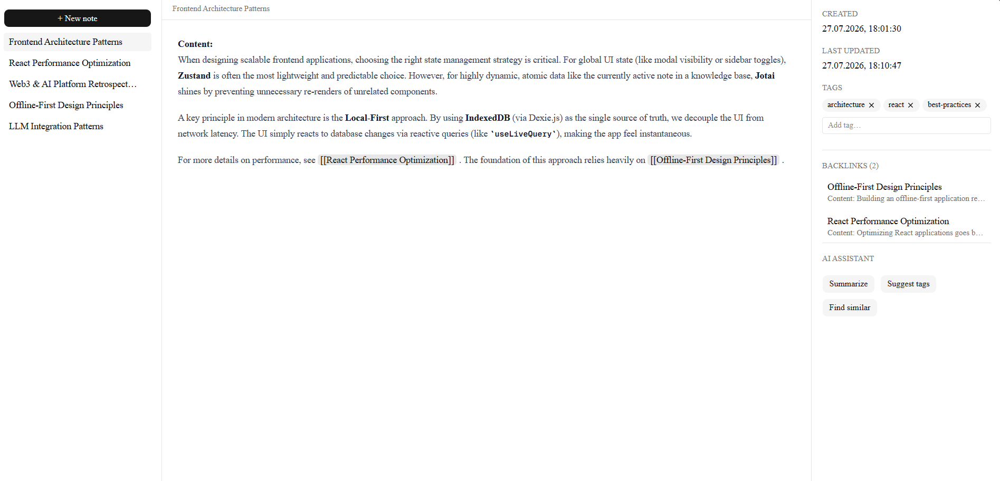
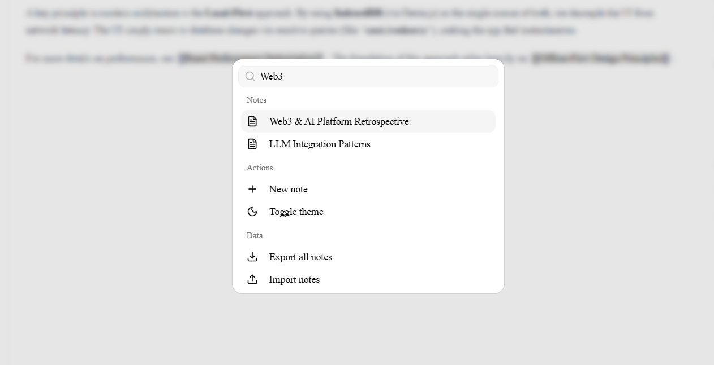
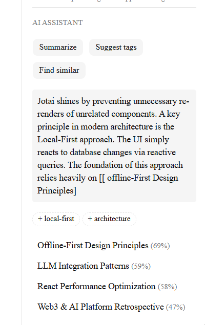
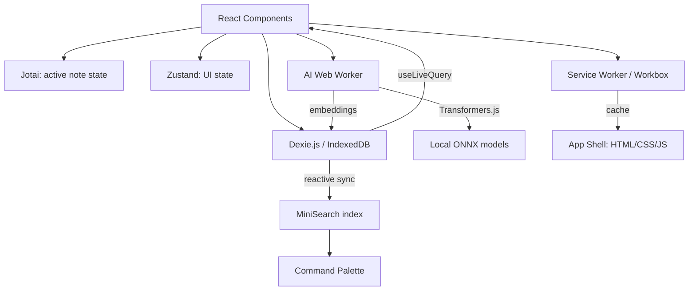

# 🧠 Offline Knowledge Base

A local-first, offline-capable knowledge management app — think Obsidian/Notion, but every byte of your data lives on your own device, and the "smart" features run entirely inside your browser, no API keys, no server, no data leaving your machine.

**[🔗 Live Demo](https://offline-knowledge-base.vercel.app/)**

### Screenshots


*Main three-column layout with wiki-links and backlinks.*


*Instant full-text search and quick actions via Ctrl+K.*


*On-device AI summarization and semantic search running in a Web Worker.*

---

## ✨ Features

- **Fully offline-first** — every note lives in IndexedDB (Dexie.js); the app works with zero network connection, and installs as a native-feeling PWA
- **Bi-directional wiki-links** — type `[[` to link notes together, with live autocomplete and automatic backlink tracking
- **Instant full-text search** — Cmd/Ctrl+K command palette powered by an in-memory MiniSearch index, sub-millisecond results
- **Local AI, no API keys** — summarization, tag suggestion, and semantic "find similar notes" — all running client-side via Transformers.js in a dedicated Web Worker
- **Responsive across devices** — adaptive navigation model: three-column layout on desktop, list ↔ editor navigation with a slide-out details panel on mobile/tablet
- **Export/Import** — full data portability via a self-contained `.zip` (lossless JSON for round-trip import + human-readable Markdown for interoperability with tools like Obsidian)
- **Keyboard-first** — every core action reachable without touching the mouse

## ⌨️ Keyboard Shortcuts

| Shortcut             | Action                                  |
| -------------------- | --------------------------------------- |
| `Cmd/Ctrl + K`       | Open command palette (search + actions) |
| `Cmd/Ctrl + J`       | Create a new note                       |
| `[[` (inside editor) | Trigger wiki-link autocomplete          |

> Note: `Cmd/Ctrl + N` was the originally planned shortcut for "new note," but it's a browser-reserved shortcut (opens a new window) that cannot be intercepted by any web app — `Ctrl+J` was chosen instead, following the precedent set by Obsidian.

## 🛠 Tech Stack

| Layer            | Choice                                                            |
| ---------------- | ----------------------------------------------------------------- |
| Framework        | Next.js 16 (App Router, Turbopack) + TypeScript (strict)          |
| Styling          | Tailwind CSS + shadcn/ui + next-themes                            |
| Local Database   | Dexie.js (IndexedDB)                                              |
| State            | Jotai (atomic note state) + Zustand (global UI state)             |
| Editor           | TipTap (ProseMirror) with a custom wiki-link node extension       |
| Search           | MiniSearch (in-memory, reactively synced with IndexedDB)          |
| AI               | Transformers.js, running in a Web Worker                          |
| Animation        | Motion (formerly Framer Motion)                                   |
| PWA              | @ducanh2912/next-pwa (Workbox)                                    |
| Data portability | fflate (zip) + Turndown (HTML→Markdown) + Zod (import validation) |
| Testing          | Vitest + React Testing Library + fake-indexeddb                   |
| Quality          | ESLint, Prettier, Husky, lint-staged                              |

## 🏗 Architecture



The core architectural principle: **IndexedDB is the single source of truth**. Every other subsystem (search index, AI embeddings, UI state) is either a reactive projection of it (via `useLiveQuery`) or an ephemeral cache rebuilt from it — nothing else holds durable state.

## 🚀 Getting Started

```bash
git clone <your-repo-url>
cd offline-knowledge-base
npm install --legacy-peer-deps
npm run dev
```

Open [http://localhost:3000](http://localhost:3000).

> `--legacy-peer-deps` is required due to an unrelated optional peer-dependency conflict between `@vitejs/plugin-react`'s optional React Compiler support and `workbox-build`'s Babel 7 requirement — see Technical Challenges below.

### Testing

```bash
npm test          # watch mode
npm run test:run  # single run
```

### Production build (required to test PWA/offline behavior — disabled in dev)

```bash
npm run build
npm run start
```

## 🧩 Technical Challenges

### 1. Reactive "broken link" detection required ProseMirror Decorations, not `renderHTML`

Wiki-links needed to visually indicate when their target note had been deleted. My first instinct was to check target existence inside the TipTap node's `renderHTML` — but ProseMirror calls `renderHTML`/`toDOM` **once**, when a node is created, and caches the resulting DOM based on the node's `attrs`. Since "does the target still exist" is external, mutable state — not part of the document itself — the check was frozen at insertion time and never re-evaluated, even after the actual data changed.

The fix was to move the check into a ProseMirror **Decoration** plugin, which is recomputed on every transaction by design. This is a good illustration of a core ProseMirror distinction: `attrs` are part of the document (serialized, undo/redo-aware), while decorations are a purely presentational layer computed fresh from current state — exactly the right tool for "does this reference still resolve," which is a fact about the world, not about the document.

### 2. Cascading deletes across a denormalized graph

Backlinks are stored denormalized (on the _target_ note, listing which notes reference it) for O(1) reads instead of a full-table scan on every note open. This meant deletion had to explicitly clean up dangling references in an atomic Dexie transaction (`db.transaction('rw', ...)`) — and required a schema version bump (`*backlinks` as a new multi-entry index) with an in-place upgrade, since IndexedDB indexes can't be queried unless declared in the store's version schema, even if the field already exists on stored objects.

### 3. React 19's stricter Compiler-era hook rules (`react-hooks/refs`, `react-hooks/set-state-in-effect`) repeatedly caught real, subtle bugs

Rather than disabling these ESLint rules, each violation was traced to its root cause and fixed architecturally:

- A `ref` read inside a TipTap extension's config (evaluated during render) was replaced with the extension's own `storage` API — TipTap's sanctioned mechanism for passing live data into ProseMirror plugins, avoiding both the lint violation and a subtle stale-closure bug where wiki-link backlinks were being attributed to the wrong note during rapid note-switching.
- `setState` calls inside `useEffect` for state genuinely derivable from existing props/data were replaced with React's "adjust state during render" pattern — eliminating an extra cascading render cycle each time, and (as a side effect) fixing a race condition between `activeNoteId` and Dexie's asynchronous `useLiveQuery` that was causing note titles to swap between notes on fast switching.
- Browser API subscriptions (`navigator.onLine`, `matchMedia`) were rebuilt on `useSyncExternalStore` instead of `useState` + `useEffect`, which simultaneously fixed a hydration mismatch (Node.js 21+ ships a partial global `navigator` without `onLine`, silently breaking a `typeof navigator !== 'undefined'` SSR guard) and the cascading-render lint violation — one primitive, two problems solved.

## 🔮 Future Improvements

- Real-time multi-device sync (CRDT-based, e.g. Yjs) on top of the existing IndexedDB layer
- Multilingual AI support — current models (`distilbart-cnn`, `nli-deberta-v3`) are English-only; Cyrillic/other-language summarization and tagging would need multilingual models (e.g. mT5, mDeBERTa) with an accepted quality trade-off
- E2E tests (Playwright) specifically for the TipTap editor, which is impractical to unit-test in jsdom
- Folder-based note organization as an alternative/complement to tags
- Swipe-to-delete gesture on mobile note list (currently delete is desktop-hover-only)

## 📄 License

MIT
